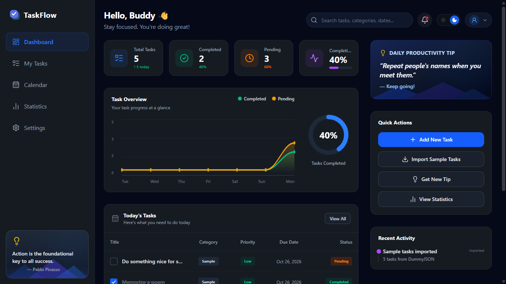
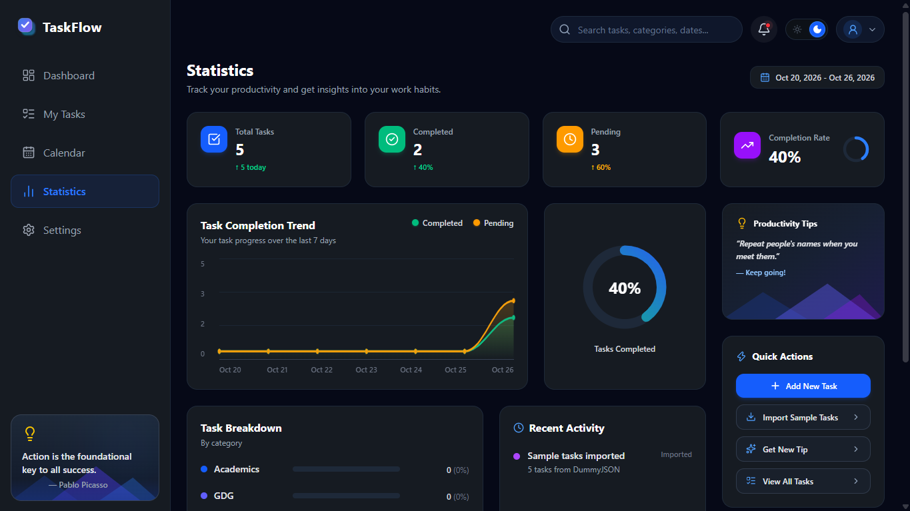
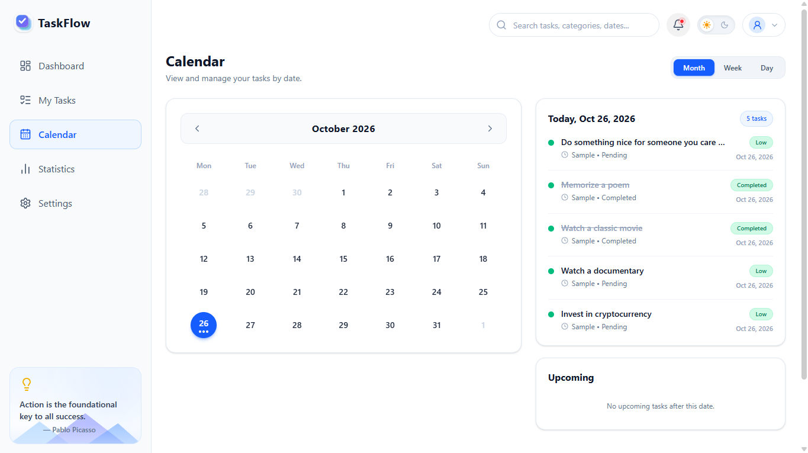
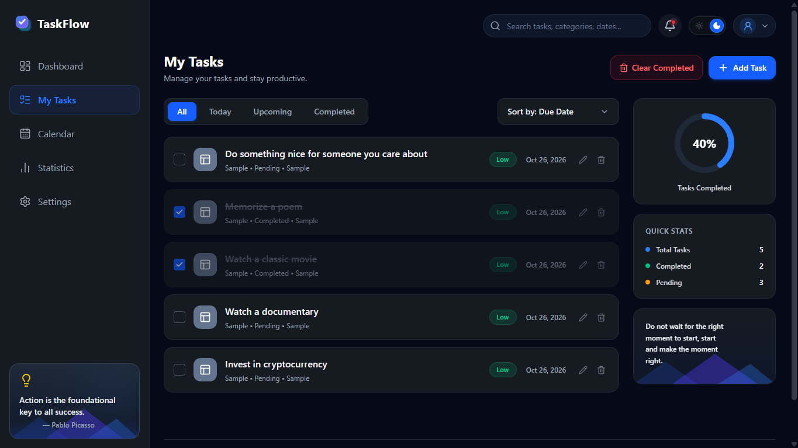
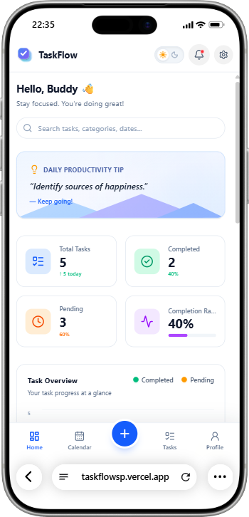
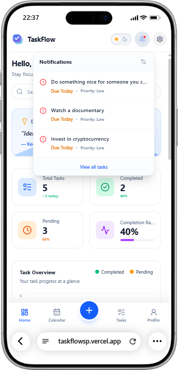
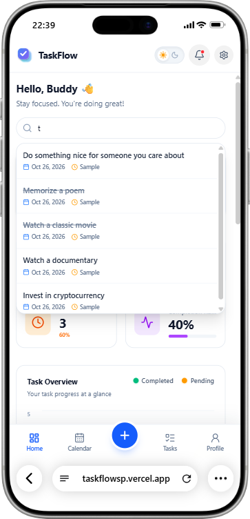
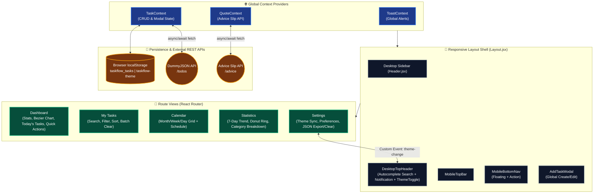
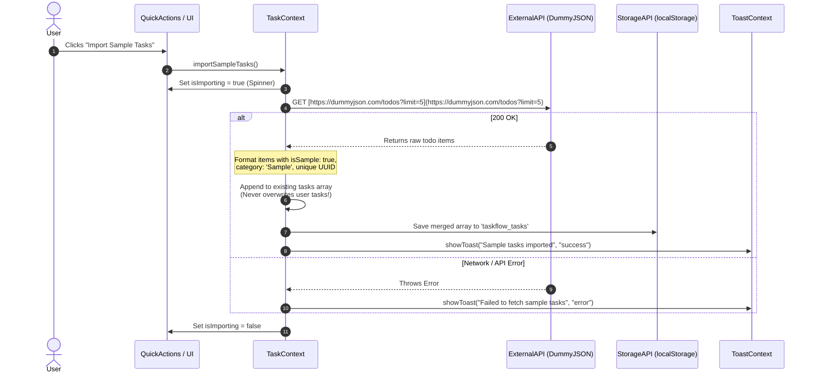

<div align="center">

  <!-- TODO: Replace with your banner image or GDG TaskFlow cover -->
  

  # TaskFlow - Task & Productivity Dashboard

  **A Local-First, Responsive Task Management & Productivity Analytics Web Application**  
  *Built for the GDG On Campus BPPIMT - 2nd Year Tech Team Selection*

  [](https://react.dev/)
  [](https://tailwindcss.com/)
  [](https://vitejs.dev/)
  [](#data-persistence--storage-schema)
  [-F59E0B?style=for-the-badge)](#objective--engineering-constraints)

  [Live Demo](https://taskflowsp.vercel.app/) • [Report Bug](https://github.com/sayantan-pachal/taskflow/issues) • [Request Feature](https://github.com/sayantan-pachal/taskflow/issues)

</div>

---

## 📌 Overview & Objective

**TaskFlow** is a client-side productivity and academic task management dashboard engineered to help students and developers organize daily workflows, track approaching deadlines, and visualize completion trends.

Built strictly in accordance with the **GDG On Campus BPPIMT Tech Team Selection** specifications, TaskFlow demonstrates core frontend engineering fundamentals:

* **Complete CRUD Lifecycle** with real-time state synchronization across multiple views (Dashboard, Tasks, Calendar, and Statistics).
* **Asynchronous REST API Integration** with non-destructive data merging and graceful error recovery.
* **Local-First Persistence** using browser `localStorage` so user tasks and preferences survive page reloads without requiring a backend server.
* **Strict Compliance:** Built with **0% AI/ML APIs or models**—relying entirely on deterministic JavaScript algorithms, custom SVG math (Cubic Bezier curve interpolation), and React Context state management.

---

## 🖼️ UI Showcase & Screenshots

### 🖥️ Desktop Experience (Dark & Light Themes)

| Main Productivity Dashboard | Analytics & Statistics View |
| :---: | :---: |
|  |  |

| Interactive Calendar (Month/Week/Day) | My Tasks (Filter, Sort & Manage) |
| :---: | :---: |
|  |  |

### 📱 Mobile-First Responsive Experience & Floating Overlays

| Mobile Dashboard & Bottom Nav | Deadline Notification Center | Global Search Autocomplete |
| :---: | :---: | :---: |
|  |  |  |

---

## 🏗️ System Architecture & Data Flow

### 1. Component & Context Hierarchy



### 2. Asynchronous API & Non-Destructive Merge Flow



---

## ✨ Features Implemented

### ✅ Core Requirements (Must-Haves)

1. **Full Task CRUD Operations:**
   * **Create:** Modal form supporting `Title`, `Category` (*GDG*, *Academics*, *Personal*), `Priority` (*High*, *Medium*, *Low*), `Status` (*Pending*, *In Progress*, *Completed*), and `Due Date`.
   * **Read:** Dynamic rendering across tabular lists, responsive cards, and calendar schedules.
   * **Update:** One-click checkbox completion toggling and full modal editing for any task.
   * **Delete:** Individual task deletion, single-click **Clear Completed**, and a protected **Clear All Tasks** action with a custom confirmation modal.
2. **Multi-Criteria Search, Filtering & Sorting:**
   * Real-time filtering by **Category**, **Priority**, and **Status**.
   * Instant sorting by **Due Date** or **Priority Weight** (*High → Medium → Low*).
   * **Global Header Autocomplete Search:** Searches across task titles, categories, and formatted dates simultaneously inside a floating dropdown.
3. **External REST API Integrations:**
   * **DummyJSON Todos API:** Imports sample tasks on demand, tagging them with `isSample: true` and merging them non-destructively with locally created tasks.
   * **Advice Slip API:** Powers the **Daily Productivity Tip** widget with skeleton loading states and on-demand refresh.
4. **Asynchronous Error Handling:**
   * Built-in `ToastContext` provides animated slide-down feedback (`success` and `error` states) for all CRUD actions, JSON exports, and network failures.

### 🚀 Advanced & Bonus Features Implemented
* **Tri-State Theme Synchronization (`Light` / `Dark` / `System`):** Synchronizes the navbar `ThemeToggle` switch and the `Settings` page in real time using custom DOM events (`theme-change`) and `window.matchMedia('(prefers-color-scheme: dark)')`.
* **📈 Interactive Smooth Bezier Curve Analytics:** Custom zero-dependency SVG charts (`TaskOverview` and `TaskCompletionTrend`) featuring dynamic Y-axis scaling, Cubic Bezier curve smoothing, gradient area fills, crosshairs, and floating hover tooltips.
* **🔔 Smart Deadline Notification Center:** A floating bell dropdown (`Notification.jsx`) that scans incomplete tasks due within 3 days, categorizes them as **Overdue**, **Due Today**, **Due Tomorrow**, or **Upcoming**, and sorts them by urgency and priority.
* **📅 Interactive Multi-View Calendar:** Supports **Month**, **Week**, and **Day** views, priority-colored indicator dots on calendar cells, dynamic **Start Week on Monday/Sunday** configuration, and direct task scheduling per date.
* **📦 Data Portability (JSON Export):** One-click backup export of `taskflow_tasks` to a dated `taskflow-backup-YYYY-MM-DD.json` file.

---

## 🔌 API Integration Reference

TaskFlow integrates two public REST APIs using native `fetch` with `async/await` and `try/catch` error boundaries. No API keys are required.

| API Name | Endpoint | Method | Purpose in TaskFlow |
| :--- | :--- | :---: | :--- |
| **DummyJSON Todos** | `https://dummyjson.com/todos?limit=5&skip={random}` | `GET` | Fetches random sample tasks, maps them to TaskFlow's schema (`category: "Sample"`), and appends them to existing local tasks. |
| **Advice Slip API** | `https://api.adviceslip.com/advice` | `GET` | Fetches random productivity tips/quotes for the `DailyTip` and `StatsRightSidebar` widgets (uses `cache: "no-store"` to ensure fresh tips). |

---

## 💾 Data Persistence & Storage Schema

All user data and preferences are persisted locally in the browser's `localStorage`:

| Storage Key | Type | Description |
| :--- | :---: | :--- |
| `taskflow_tasks` | `JSON Array` | Stores all user-created and imported tasks (`id`, `title`, `category`, `priority`, `status`, `rawDate`, `date`, `checked`, `isSample`). |
| `taskflow-theme` | `String` | Stores active theme preference (`"light"`, `"dark"`, or `"system"`). |
| `taskflow_notifs` | `Boolean` | Toggles the global deadline notification engine on or off. |
| `taskflow_deadlines` | `Boolean` | Toggles approaching deadline alerts inside the notification dropdown. |
| `taskflow_monday_start` | `Boolean` | Configures the Calendar grid to start weeks on Monday (`true`) or Sunday (`false`). |

---

## 📂 Project Directory Structure

```text
taskflow/
├── public/
│   └── favicon.svg
├── src/
│   ├── components/
│   │   ├── Header/
│   │   │   ├── Header.jsx              # Desktop navigation sidebar
│   │   │   ├── DesktopTopHeader.jsx    # Greeting, Search autocomplete, Bell, ThemeToggle
│   │   │   ├── MobileTopBar.jsx        # Sticky mobile top bar
│   │   │   └── MobileBottomNav.jsx     # Fixed mobile bottom nav with floating + button
│   │   ├── Footer/
│   │   │   └── Footer.jsx
│   │   ├── Modal/
│   │   │   └── AddTaskModal.jsx        # Global Create / Edit Task modal
│   │   └── Others/
│   │       ├── CustomDropdown.jsx      # Accessible custom select component
│   │       ├── Notification.jsx        # Deadline reminder floating dropdown
│   │       ├── ThemeToggle.jsx         # Real-time synced Sun/Moon switch
│   │       └── ToastContext.jsx        # Animated top-drop toast notification provider
│   ├── context/
│   │   ├── TaskContext.jsx             # Global task CRUD, modal state & DummyJSON import
│   │   └── QuoteContext.jsx            # Advice Slip API state & refresh handler
│   ├── pages/
│   │   ├── Dashboard/
│   │   │   ├── Dashboard.jsx
│   │   │   └── Parts/
│   │   │       ├── StatsCards.jsx
│   │   │       ├── TaskOverview.jsx    # Smooth Bezier curve chart + hover window
│   │   │       ├── TodaysTasks.jsx     # Custom responsive grid table
│   │   │       ├── DailyTip.jsx
│   │   │       ├── QuickActions.jsx
│   │   │       └── RecentActivity.jsx
│   │   ├── MyTasks/
│   │   │   └── MyTasks.jsx             # Full task management, filtering & sorting
│   │   ├── Calendar/
│   │   │   ├── Calendar.jsx
│   │   │   └── Parts/
│   │   │       ├── CalendarHeader.jsx
│   │   │       ├── CalendarGrid.jsx
│   │   │       └── CalendarSchedule.jsx
│   │   ├── Statistics/
│   │   │   ├── Statistics.jsx
│   │   │   └── Parts/
│   │   │       ├── StatsOverviewCards.jsx
│   │   │       ├── TaskCompletionTrend.jsx
│   │   │       ├── TaskBreakdown.jsx
│   │   │       ├── StatsRecentActivity.jsx
│   │   │       └── StatsRightSidebar.jsx
│   │   ├── Settings/
│   │   │   └── Settings.jsx            # Theme sync, toggles, JSON export & custom alert modal
│   │   └── Profile/
│   │       └── Profile.jsx
│   ├── utils/
│   │   └── api.js                      # StorageAPI (localStorage) & ExternalAPI (Fetch)
│   ├── Layout.jsx                      # Master responsive viewport shell
│   ├── ScrollToTop.jsx                 # Smooth container scroll restoration
│   ├── main.jsx
│   └── index.css                       # Tailwind imports & native date-picker overrides
├── package.json
├── vite.config.js
└── README.md
```

---

## 🛠️ Local Setup & Installation

Follow these steps to run **TaskFlow** locally on your machine:

### 1. Prerequisites
* **Node.js** (v18.0.0 or higher recommended)
* **npm** or **pnpm**

### 2. Clone the Repository
```bash
git clone [https://github.com/sayantan-pachal/taskflow.git](https://github.com/sayantan-pachal/taskflow.git)
cd taskflow
```

### 3. Install Dependencies
```bash
npm install
```

### 4. Start the Development Server
```bash
npm run dev
```
Open [http://localhost:5173](http://localhost:5173) in your browser to view the application.

### 5. Build for Production
```bash
npm run build
npm run preview
```

---

## 👨‍💻 Author

**Sayantan Pachal**  
*B.Tech in Computer Science & Engineering (2nd Year)*  
*B. P. Poddar Institute of Management and Technology (BPPIMT)*

* 🌐 **Portfolio:** [sayantanpachal.me](https://sayantanpachal.me)
* 💻 **GitHub:** [@sayantan-pachal](https://github.com/sayantan-pachal)
* 🔗 **LinkedIn:** [Sayantan Pachal](https://linkedin.com/in/sayantan-pachal)